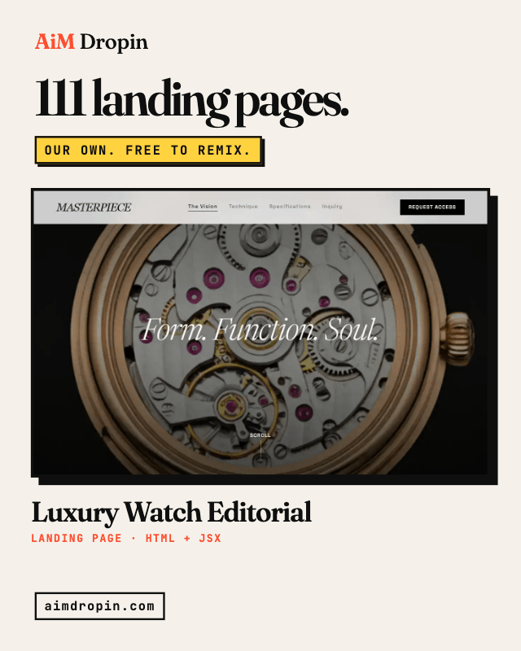

# AiM Dropin


Free landing pages, live dashboards and UI components for vibecoders. Preview anything live, remix it in your browser, then copy the code or download it. No sign-in.

**[www.aimdropin.com](https://www.aimdropin.com)**



## Made for the community

AiM Dropin is free and open source because a community made it possible. Use it, fork it, learn from it, and send improvements back.

## What's inside

- 111 landing pages, each in HTML and JSX
- 167 live dashboards you can click through, built from their original open-source repos
- 6,873 UI components from 16 MIT-licensed sources
- 3 complete websites built with GSAP (Sum, Meridian and Datum), each with its code and a browser check in [components/gsap](components/gsap)
- A playground to paste your own AI-made code and edit it visually

## Run it locally

You need Node.js 20.9 or later.

```bash
npm install
npm run dev
```

Then open `http://localhost:3000`. Every setting in `.env.example` is optional. The live dashboard demos need their built files: see [scripts/dashboards](scripts/dashboards/README.md).

## Licence

MIT, see [LICENSE](LICENSE). Third-party components, dashboards and icons keep their own licences, listed in [THIRD_PARTY_NOTICES.md](THIRD_PARTY_NOTICES.md). The GSAP sites' own code is MIT; GSAP itself is not, and is free to use under [its own licence](https://gsap.com/standard-license). The AiM Dropin name, logo and wolf mascot aren't covered by the licence.

Found a security issue? Please see [SECURITY.md](SECURITY.md).

## Made by

[Nikita Akella](https://www.linkedin.com/in/nikita-akella-41b728368/) at [Akella inMotion](https://www.linkedin.com/company/akella-inmotion/). Built with Claude Code, Supabase and Vercel, with thanks to every open-source author in [THIRD_PARTY_NOTICES.md](THIRD_PARTY_NOTICES.md).
